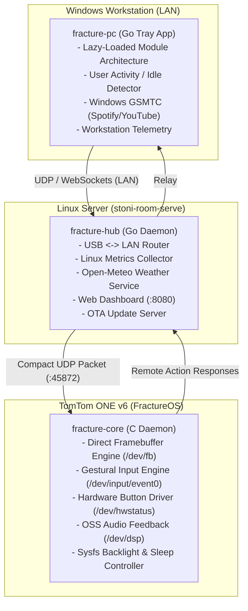

# FractureOS

> **A high-performance, modular smart desk operating system and PC telemetry companion for the TomTom ONE v6 (OpenTom Linux 2.6.13, ARM926EJ-S @ 264MHz).**

---

## Overview

FractureOS repurposes legacy TomTom ONE v6 hardware into an always-on, elegant smart desk companion and PC battle-station dashboard.

### Core Highlights
- **Direct Framebuffer Graphics (`/dev/fb`)**: Double-buffered 320x240 RGB565 rendering with dirty-rect updates; renders in < 4ms and maintains 0% CPU at idle.
- **Cracked-Screen Gestural Engine**: Designed specifically for damaged digitizers that register touch contact but erratic coordinates. Navigates purely via rhythmic single taps, double taps, long taps, and hardware power-button duration ioctls (`IOR_BUTTON_EVENT`).
- **Dynamic Context Switching (Busy vs Zen)**:
  - When actively working on Windows, FractureOS displays rich dashboard complications and telemetry.
  - When stepping away or idle for > 5 minutes, it automatically transitions into a clean, distraction-free Zen Clock.
- **6-Tile App Launcher**:
  1. **Clock**: Hero Desk Clock with customizable styles, date, and live complications.
  2. **Telemetry**: PC & Workstation gauges (CPU%, GPU%, RAM%, GPU Temp, Network Speed, 40s sparklines).
  3. **Spotify**: Windows GSMTC media controller with marquee track ticker, duration scrubber, and animated soundwaves.
  4. **Pomodoro**: Desk focus & short-break timer with audio alerts on `/dev/dsp`.
  5. **Server**: 24/7 host health metrics for `stoni-room-serve` (Ubuntu NAS).
  6. **Settings**: On-device brightness slider (0-100%), night/amber mode, and tap audio toggles.
- **Over-The-Air (OTA) Updates**: Hot-deploy new C binaries over the USB network in under 2 seconds via `tools/deploy.sh` or `fracture-cli`.

---

## Architecture



---

## Directory Structure

```
/home/sepisotoni/projects/FractureOS/
├── README.md                    # Project documentation
├── tools/
│   └── deploy.sh                # Instant OTA deployment to TomTom
├── device/                      # Native C Runtime for TomTom ONE v6
│   ├── Makefile                 # Cross-compile Makefile (gcc 3.3.4 / glibc 2.3.2)
│   ├── core/
│   │   ├── main.c               # Event loop & signal handler
│   │   ├── framebuffer.c/.h     # Direct /dev/fb mmap & graphics primitives
│   │   ├── input.c/.h           # Cracked-screen tap & power button engine
│   │   ├── audio.c/.h           # /dev/dsp PCM audio buzzer
│   │   ├── backlight.c/.h       # /sys/class/backlight/s3c controller
│   │   ├── network.c/.h         # UDP binary telemetry receiver
│   │   └── protocol.h           # Shared 256-byte packed packet
│   └── ui/
│       ├── font_data.h          # Baked bitmap fonts (small, normal, digits)
│       ├── chrome.c/.h          # Header bar, non-colliding pill footers, toasts
│       ├── view_manager.c/.h    # View coordinator & state switcher
│       └── views/
│           ├── view_clock.c     # Hero clock & Zen face
│           ├── view_launcher.c  # 6-tile App Menu carousel
│           ├── view_telemetry.c # PC gauges & sparklines
│           ├── view_media.c     # Spotify / media controller
│           ├── view_timer.c     # Pomodoro desk timer
│           ├── view_server.c    # Linux host health
│           └── view_settings.c # Display lux & preferences
└── companion/                   # Go Companion Suite
    ├── go.mod
    ├── shared/
    │   └── protocol.go          # Binary serialization & constants
    ├── hub/                     # 24/7 Linux Server Daemon
    │   ├── main.go
    │   ├── server_metrics.go    # /proc host metrics
    │   ├── weather.go           # Open-Meteo weather
    │   └── web.go               # Web Dashboard (:8080)
    ├── pc/                      # Windows Tray Companion (fracture-pc.exe)
    │   └── main.go              # Lazy-loaded modules & GSMTC media
    └── cli/                     # Developer CLI Tool (fracture-cli)
        └── main.go              # Command-line remote controller
```

---

## Building & Running

### 1. Build Device C Runtime
```bash
make -C device
```

### 2. Deploy to TomTom via OTA
```bash
./tools/deploy.sh
```

### 3. Build Go Companion Suite
```bash
cd companion
# Build Linux Hub & CLI
go build -o bin/fracture-hub ./hub
go build -o bin/fracture-cli ./cli

# Cross-compile Windows Companion
GOOS=windows GOARCH=amd64 go build -o bin/fracture-pc.exe ./pc
```

### 4. Run the Linux Hub
```bash
./companion/bin/fracture-hub
# Web dashboard accessible at: http://192.168.101.114:8080
```
